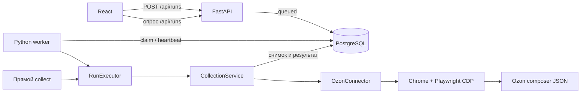

# Архитектура Marketplace Price Analyzer

Этот обзор описывает поведение, подтверждённое исходным кодом. Он не подтверждает
успешный запуск приложения, работу текущего ответа Ozon или состояние пользовательской
базы. Практические команды и диагностика находятся в [руководстве](../guide/README.md),
предложения по развитию — в [backlog](../BACKLOG.md).

## Режимы и процессы

| Режим | Точка входа | Процессы и хранилище |
| --- | --- | --- |
| Desktop | `./price-watch`, `frontend/src-tauri/src/lib.rs` | Tauri с React; локальные PostgreSQL, Xvfb, FastAPI и Python worker; системный Chrome открывается для ручной работы или сбора |
| Browser E2E fixture | `npm --prefix frontend run dev:e2e` | Mock API в браузере; PostgreSQL и Ozon не используются |
| API и worker без UI | `main.py api`, `main.py worker` | Используют заданный `DATABASE_URL`; API обслуживает desktop и CLI |
| Прямой сбор CLI | `main.py collect` | CLI сам вызывает сервис сбора и пишет в PostgreSQL, не ожидая worker |
| JSON одного товара | `main.py <числовой артикул>` | Ozon → нормализованный JSON (или исходный ответ с `--raw`); `DATABASE_URL` не нужен |

`main.py` импортирует оба CLI до выбора режима. Поэтому JSON-режиму не нужна база,
но нужен установленный набор Python-пакетов, импортируемый CLI анализатора.

В desktop Rust запускает и контролирует службы независимо от загрузки React;
`ensure_services` отдаёт интерфейсу текущее подключение и позволяет повторить
запуск после ошибки. Rust проверяет системные программы, создаёт или открывает
локальный кластер PostgreSQL в каталоге XDG,
проверяет его основную версию, создаёт резервную копию, поднимает Xvfb и API,
затем запускает worker. API слушает свободный порт `127.0.0.1`; Tauri передаёт
интерфейсу адрес и токен сессии и обновляет их после перезапуска API. UI обращается к API по HTTP с заголовком
`X-Price-Watch-Token`. Проверка токена в FastAPI включается, когда токен задан.
При штатном выходе Tauri останавливает дочерние процессы и создаёт ещё одну
резервную копию. Эти службы работают, пока открыт desktop-процесс.

Источники: `frontend/src/app/App.tsx`, `frontend/src/api/client.ts`,
`frontend/src-tauri/src/lib.rs`, `frontend/src-tauri/src/native_services.rs`,
`price_analyzer/api/app.py`, `main.py`.

## Путь сбора

API фиксирует состав запуска в `collection_run_targets` при постановке в очередь.
Worker атомарно забирает `queued` через `FOR UPDATE SKIP LOCKED`, обновляет
heartbeat каждые пять секунд и при следующем цикле помечает зависшие
`running` или `waiting_for_user` как `failed`. При работающем worker раз в
минуту проверяется необходимость полного сбора: срок — 6 часов от начала
последнего полного запуска; активный запуск не дублируется. При включённом
фоновом режиме Tauri запускается после входа в графическую сессию со скрытым
окном, владеет службами и продолжает сбор после закрытия окна. Повторный запуск
ярлыка показывает существующее окно; полный выход останавливает службы.

`CollectionService` открывает один сеанс коннектора на маркетплейс и выполняет
до пяти запросов карточек одновременно. Сетевой вызов происходит вне транзакции
БД, результаты сохраняются по мере завершения. `ProductNotFound` превращается
в успешное наблюдение `out_of_stock`; прочие ошибки карточек записываются в
запуск с сообщением и traceback, не прерывая остальные карточки. Общая ошибка
запуска переводит его в `failed`. Прямой CLI и worker используют один
`RunExecutor`: токен владельца, heartbeat, создание коннекторов и cleanup.
CLI создаёт owned запуск сразу в running и восстанавливает устаревшие записи
до старта. Worker делает то же до проверки расписания, включая ownerless записи.
Сохранение результата цели, карточки, истории и счётчиков атомарно. Все записи
исполнителя проверяют lease; потеря владения отменяет запросы и закрывает сеансы.
Повтор выбирает существующие supported цели failed/pending/unknown, исключая
succeeded даже без новой точки истории.

Источники: `price_analyzer/api/routes/runs.py`,
`price_analyzer/infrastructure/postgres/runs_repository.py`,
`price_analyzer/worker/worker.py`, `price_analyzer/application/collection_service.py`,
`price_analyzer/cli.py`.

## Контракты и границы

- `GET /api/catalog` возвращает cards/groups/deals из одной read-only
  транзакции REPEATABLE READ с общими исходными данными. UI обновляет весь снимок
  вместе и сохраняет прежний снимок при ошибке обновления. Старые GET списков
  cards/groups/deals удалены; мутации и details/history/chart остаются.
  Остальные маршруты: `/api/cards`, `/api/groups`, `/api/runs`, `/api/health`.
  Pydantic преобразует имена полей в `camelCase`; TypeScript-типы и вызовы
  находятся в `frontend/src/types/domain.ts` и `frontend/src/api/client.ts`.
- Коннектор обязан предоставить асинхронные `get_product` и
  `collection_session`. Он возвращает общий `ProductSnapshot`; JSON-схема
  снимка — `marketplace_connector/serialization/product.schema.json`.
  Реальный коннектор сейчас есть только для Ozon.
- Ozon-клиент использует системный Chrome с постоянным профилем и Playwright
  по локальному CDP. Он открывает страницу товара, запрашивает composer JSON
  из неё, проверяет ответ и передаёт его mapper’у. Цена берётся из
  `cardPrice`; внешний ID нормализуется как строка цифр. В desktop worker
  работает на скрытом дисплее: требующая участия пользователя антибот-проверка
  завершает карточку ошибкой. В видимом CLI подтверждение возможно в терминале.
- Карточки Wildberries, AliExpress и Яндекс Маркета можно добавить через API/UI,
  но они исключаются из запусков сбора до появления коннекторов.

Источники: `price_analyzer/api/schemas.py`, `price_analyzer/domain/marketplaces.py`,
`marketplace_connector/application/product_service.py`,
`marketplace_connector/connectors/ozon/async_client.py`,
`marketplace_connector/connectors/ozon/mapper.py`.

Очередь уведомлений о выгодной цене хранит pending ID, watermark и цены одним
документом localStorage. Ошибка API оставляет работу для повтора с backoff
до 30 секунд независимо от закрытия панели. Обработка фиксируется после
свежего каталога; учитываются актуальные deals с подходящим lastCollectionRunId
и изменённой ценой. Это не доставка всех исторических скидок.

## Данные и совместимость

SQLAlchemy-модели отделены от доменных объектов. Основные таблицы:
`marketplace_cards` (уникальная пара `marketplace, external_id`),
`product_groups`, `collection_runs`, `collection_run_targets` и `price_history`.
Группа выбирает представителя по минимальной известной цене, независимо от
наличия; при равенстве цен или отсутствии цен — меньший ID. Все её товарные
метрики, в том числе исторический минимум, принадлежат этому представителю;
сбор всё равно идёт по карточкам. Флаг
`deals_enabled` влияет на список выгодных предложений, но не исключает
карточку из сбора.

Наблюдение содержит цену, наличие, время, ID запуска и JSON-снимок. Текущий
сбор добавляет строку только при изменении цены или наличия относительно
последней сохранённой точки. Миграция `0004` оставляла первую и последнюю
точки старого участка одинакового состояния, поэтому ранее записанная история
может содержать обе. `updated_at` карточки может обновиться без новой точки. Удаление
карточки каскадно удаляет её историю; во время активного запуска удаление
запрещено. Импорт документа версии 2 выполняется транзакционно, объединяет
истории по времени и может удалить из локальной истории одинаковые соседние
состояния. Предпросмотр рассчитывает итог без записи. Экспорт содержит карточки,
группы и сохранённые точки истории, но не JSON-снимки и не запуски.

Миграции Alembic идут от `0001_initial` до `0014_run_target_results`. Миграция
`0004` удаляет часть старых наблюдений без возможности восстановить их через
`downgrade`. API применяет
их при старте через синхронное подключение, CLI — по команде `db migrate`.
Ревизия 0014 сохраняет известные цели и данные, обозначает недоказанные
результаты unknown и неполный состав, затем удаляет старый массив целей.
Переход forward-only, смешанные версии не поддерживаются: перед обновлением
остановить старые API/worker/CLI.
Есть механизм принятия старой схемы без таблицы `alembic_version` за `0001`.
Перед запуском миграций на существующих данных нужно изучить их конкретные
ревизии и резервную копию. Подробные маршруты, поля и статистика описаны в
[данных и API](../guide/DATA_AND_API.md).

Источники: `price_analyzer/infrastructure/postgres/models.py`,
`history_repository.py`, `groups_repository.py`, `transfer_repository.py`,
`migrations.py` в том же каталоге, а также `price_analyzer/domain/history_merge.py`.

## Проверка изменений

Из корня репозитория: `.venv/bin/python -m unittest discover -s tests -v`,
`npm --prefix frontend run lint` (проверка TypeScript),
`npm --prefix frontend test`, `npm --prefix frontend run test:e2e`,
`npm --prefix frontend run desktop:build`,
`cargo test --locked --manifest-path frontend/src-tauri/Cargo.toml`.
Браузерный E2E запускает тестовый UI с mock API; интеграционный тест PostgreSQL требует отдельной базы
в `TEST_DATABASE_URL`, применяет миграции и меняет её данные. Команды сборки,
браузер и живой Ozon требуют отдельной эксплуатационной проверки.

OpenSpec хранит утверждённое поведение и изменения, когда для них созданы
спецификации. Этот обзор, [ADR](../adr/README.md), backlog, команды запуска
и системные зависимости нужно сверять с кодом при соответствующих изменениях.
