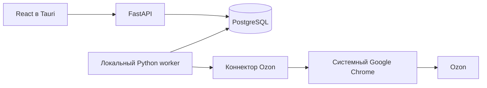

# Архитектура и путь данных

[К содержанию](README.md)

## Компоненты

| Часть | Код | Задача |
| --- | --- | --- |
| Запуск desktop | `price-watch`, `frontend/src-tauri/src/lib.rs` | Открыть Tauri, поднять сервисы и локальный worker |
| Интерфейс | `frontend/src` | Карточки, история, запуски, выгодные предложения и действия пользователя |
| HTTP API | `price_analyzer/api` | Проверить запросы и передать их репозиторию |
| Сбор и очередь | `price_analyzer/application`, `price_analyzer/worker` | Выполнить сбор, обновить прогресс и статусы |
| Хранение | `price_analyzer/infrastructure/postgres` | PostgreSQL, SQLAlchemy и Alembic |
| Контракт коннектора | `marketplace_connector/domain`, `marketplace_connector/ports` | Общая модель снимка товара |
| Ozon | `marketplace_connector/connectors/ozon` | Chrome, ответ Ozon и нормализация |
| Старый одиночный CLI | `ozon_article_json`, `main.py` | Получить JSON товара без БД |

## Сбор через интерфейс

1. React просит Tauri закрыть вручную открытый Chrome, затем отправляет `POST /api/runs`
   для одной карточки или всех активных.
2. API создаёт строку запуска со статусом `queued` и фиксирует ID выбранных карточек в PostgreSQL.
3. Worker раз в секунду ищет очередь и атомарно забирает один запуск через
   `FOR UPDATE SKIP LOCKED`. Статус становится `running`.
   Раз в минуту worker также проверяет 12-часовой срок и при необходимости
   создаёт полный запуск без дублирования активной очереди.
4. При запуске сбора worker открывает системный Chrome с профилем
   `.playwright-profile` на скрытом дисплее и подключается через локальный CDP.
   Сеанс остаётся открытым до конца запуска.
5. Коннектор открывает до пяти вкладок одновременно, получает JSON Ozon из
   каждой вкладки и закрывает её после обработки.
   Mapper создаёт общий `ProductSnapshot`; цена берётся только из `cardPrice`.
6. Репозиторий обновляет название и ссылку карточки; снимок в `price_history`
   добавляется при изменении цены или наличия. Ошибки по товарам сохраняются с traceback
   в запуске. Интерфейс опрашивает запуск примерно раз в секунду и обновляет
   карточки после завершения.

Сетевые вызовы Ozon выполняются параллельно вне транзакции БД. Результаты
сохраняются в PostgreSQL по одному по мере завершения запросов. Ошибка одной
карточки увеличивает `failure_count`, но остальные карточки продолжают
обрабатываться.

Контракт каждого коннектора требует `async get_product` и асинхронный
`collection_session`. API, worker и сервис сбора используют `await` для
обращений к PostgreSQL через SQLAlchemy `AsyncSession`. Репозиторий разделён
на области карточек, запусков, истории, импорта/экспорта и выгодных
предложений; общий фасад сохраняет прежнюю точку входа. Миграции Alembic
выполняются через отдельное синхронное соединение при запуске API или командой CLI.

## Проверка Ozon

В desktop режиме worker использует скрытый дисплей. Если Ozon требует ручную
проверку, запуск завершается с ошибкой; пользователь может открыть Chrome
кнопкой, пройти проверку и повторить сбор. В web режиме
пользователь может открыть noVNC: worker устанавливает статус `waiting_for_user`,
после проверки кнопка «Проверка пройдена» вызывает
`POST /api/runs/{id}/continue`, и worker продолжает работу. При прямом CLI
сборе подтверждение принимается в терминале.

## Три способа использовать один коннектор

- UI и API создают запуск в очереди; его выполняет фоновый worker.
- `main.py collect` вызывает сервис сбора напрямую и блокирует терминал до
  окончания.
- `main.py <артикул>` получает один нормализованный JSON без PostgreSQL.

Общий формат снимка описан в
`marketplace_connector/serialization/product.schema.json`. Сейчас реальный
коннектор реализован только для Ozon.
