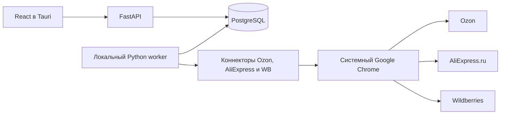

# Архитектура и путь данных

[К содержанию](README.md)

Сводная схема процессов, режимов и контрактов находится в
[обзоре архитектуры](../architecture/overview.md).

## Компоненты

| Часть | Код | Задача |
| --- | --- | --- |
| Запуск desktop | `price-watch`, `frontend/src-tauri/src/lib.rs`, `native_services.rs` | Открыть Tauri, поднять сервисы и локальный worker |
| Интерфейс | `frontend/src` | Карточки, история, запуски, выгодные предложения и действия пользователя |
| HTTP API | `price_watch/api` | Проверить запросы, вызвать сервис каталога или нужный порт хранения |
| Правила и сборка | `price_watch/domain`, `application`, `ports`, `bootstrap.py` | Правила каталога и расписания, проекции и явные зависимости потребителей |
| Сбор и очередь | `price_watch/application`, `price_watch/worker` | Выполнить сбор, обновить прогресс и статусы |
| Хранение | `price_watch/infrastructure/postgres` | PostgreSQL, SQLAlchemy и Alembic |
| Контракт коннектора | `marketplace_connector/domain`, `marketplace_connector/ports` | Общий MarketplaceCard и независимый от площадки порт |
| Chrome | `marketplace_connector/browser` | Процесс, профиль, CDP, acquire/release и согласование ручных проверок |
| Ozon | `marketplace_connector/connectors/ozon` | Composer JSON и нормализация |
| AliExpress | `marketplace_connector/connectors/aliexpress` | SKU identity, productData и нормализация одной цены |
| Wildberries | `marketplace_connector/connectors/wildberries` | nmId:optionId, runtime витрины и одна цена с приоритетом WB Кошелька |
| Одиночный CLI | `marketplace_connector/connectors/ozon/cli.py`, `main.py` | Получить JSON товара без БД |

Рабочий интерфейс запускается только в Tauri. Браузерный `dev:e2e` использует
mock API для проверки UI и не подключается к живым службам.

## UI-слой

Интерфейс использует shadcn/ui из официального `@shadcn`, Radix, Tailwind 4
и Lucide. Локальные примитивы находятся в `frontend/src/components/ui`,
предметные композиции — в `frontend/src/components/product`, логика экранов —
в feature-компонентах и hooks. Recharts отвечает за графики истории цен.
Тема задана в `src/styles/tokens.css`, семантические Tailwind mappings и
порядок CSS layers — в `src/styles/global.css` относительно `frontend/`.

Меню, панели и подтверждения используют DropdownMenu, Sheet, Dialog и
AlertDialog; выпадающие списки — Select с общей темой. При изменениях
сохраняются клавиатурная навигация и восстановление фокуса.
Правила сопровождения: `frontend/AGENTS.md`; решение и альтернативы:
[ADR 0003](../adr/0003-shadcn-ui-primitives.md).

## Модели товара и отслеживания

`marketplace_connector.domain.models.MarketplaceCard` — общий результат любого
коннектора: ProductRef, данные товара, Decimal-цена, наличие и collected_at.
`price_watch.domain.models.TrackedCard` — локальная запись отслеживания с ID,
ref, отображаемыми полями, группой, тегами и настройками. Она использует
существующую таблицу marketplace_cards; дополнительной таблицы нет.
`TrackedCardOverview` и frontend `TrackedCardView` — проекции записи и метрик.

У каждой площадки собственные модель входных данных и mapper. Потребители
общего товара не разбирают Ozon-структуры. Числовой CLI получает товар без БД.
Деньги передаются в JSON строками; формат описан в [контракте данных](DATA_AND_API.md).
Мотивы и альтернативы: [ADR 0005](../adr/0005-marketplace-card-and-tracking-record.md).

## Сбор через интерфейс

1. При ручном сборе React просит Tauri закрыть вручную открытый Chrome, затем
   отправляет `POST /api/runs` для одной карточки или всех карточек с
   подключённым коннектором. Исключение из выгодных предложений не исключает
   карточку из сбора.
2. API создаёт строку запуска со статусом `queued` и фиксирует цели в `collection_run_targets`.
3. Worker раз в секунду ищет очередь и атомарно забирает один запуск через
   `FOR UPDATE SKIP LOCKED`. Статус становится `running`, исполнение получает отдельный токен владельца.
   Раз в минуту worker также проверяет 6-часовой срок и при необходимости
   создаёт полный запуск без дублирования активной очереди.
4. Общий `RunExecutor` запускает heartbeat и создаёт коннекторы внутри lifecycle. Worker открывает системный Chrome с профилем из
   пользовательского каталога данных на скрытом дисплее и подключается через локальный CDP.
   Builder передаёт трём клиентам один `ChromeSession` с acquire/release;
   последний потребитель штатно закрывает браузер. Старый Ozon lifecycle удалён.
   Каждая площадка владеет своим транспортом и страницей.
5. Коннектор открывает одну страницу `https://www.ozon.ru/` на сеанс и выполняет
   до пяти параллельных `fetch` к `/api/composer-api.bx/page/json/v2` с
   `url=<закодированный /product/{sku}/>` и `credentials: "include"`.
   Навигации на карточки нет; авторизация и регион остаются в профиле Chrome.
   Транспорт проверяет HTTP-статус, тип ответа и структуру JSON, сохраняя исходный
   успешный текст для raw. Таймаут 30 секунд охватывает получение тела;
   отмена затрагивает только свой запрос. До трёх HTTP-попыток используют общие
   ограничения параллелизма и частоты (5 стартов/сек с начальным запасом 5).
   `Retry-After` задерживает все новые отправки; ожидание свыше 30 секунд
   завершается `RateLimited` без раннего повтора. Восстановление общей страницы
   выполняется не более одного раза за сеанс после завершения активных запросов.
   Повторный отказ доступа блокирует новые отправки в этом сеансе.
   Parser создаёт `OzonProductData`, затем `OzonMapper` преобразует его в общий
   `MarketplaceCard`; цена берётся только из `cardPrice` и нормализуется как Decimal.
   AliExpress открывает `https://aliexpress.ru/` и вызывает
   `/aer-jsonapi/v1/bx/pdp/web/productData` с productId/sourceId=0/sku_id.
   Parser проверяет точную пару и выбранную строку SKU, mapper возвращает одну
   Decimal-цену coupon → activity → regular. Политика ограничений такая же,
   transports независимы; общий challenge lock согласует только ручное участие.
   WB готовит контекст профиля и условия кошелька, затем получает detail JSON
   через runtime на главной. Проверяются точные nmId/optionId; возвращается одна
   Decimal-цена с приоритетом WB Кошелька. Повторы витрины ограничены транспортом.
   Общий validator идентичностей находится в application/card_identity.py.
   Подробности и перенос данных — [Wildberries](WILDBERRIES.md), [ADR 0009](../adr/0009-wildberries-size-and-wallet-price.md).
6. `RunRepository.save_result` заполняет пустое название карточки и обновляет ссылку, если она
   получена с площадки; снимок в `price_history`
   добавляется при изменении цены или наличия. Ошибки по товарам сохраняются с traceback
   в запуске. Интерфейс опрашивает запуск примерно раз в секунду и обновляет
   карточки после завершения.

Сетевые вызовы площадок выполняются параллельно вне транзакции БД. Результаты
сохраняются в PostgreSQL по одному по мере завершения запросов. Карточка,
история, результат цели и счётчики фиксируются атомарно под проверкой lease.
Повтор результата не дублирует историю или прогресс. Потеря владения отменяет
fetch-задачи и закрывает сеансы; старый исполнитель не может писать или завершить запуск. Ошибка одной
карточки увеличивает `failure_count`, но остальные карточки продолжают
обрабатываться.

Контракт каждого коннектора требует `async get_product` и асинхронный
`collection_session`. API, worker и сервис сбора используют `await` для
обращений к PostgreSQL через SQLAlchemy `AsyncSession`. API, worker и исполнитель
получают отдельные порты; `bootstrap.py` собирает самостоятельные адаптеры
карточек, запусков, чтения истории, групп и импорта/экспорта без наследуемого фасада.
`PostgresCatalogReader` читает типизированные входы в одном read-only снимке
REPEATABLE READ, а `CatalogService` строит cards/groups/deals после закрытия
транзакции. UI публикует их одной записью кеша.
`useCatalogModel` готовит фильтры, порядок и состав групп; отдельные memo-компоненты
отображают строки, плитки и заголовки групп. Видимые строки списка/сетки, участники
больших групп и кандидаты редактора виртуализированы; полная модель снимка и выбор
ID сохраняются в памяти. Контекст команд сбора отделён от прогресса, поэтому
неизменившийся каталог не перерисовывается при каждом heartbeat.
История/график и экспорт выбирают только нужные поля без raw snapshot.
Диагностика хранится в существующем `collection_runs.errors`, максимум 20/128 KiB
только у последнего созданного запуска. Shared/exclusive advisory guard сериализует
очистку при создании с записью результатов; lease/цели/счётчики остаются атомарными.
Один Rust drain обслуживает stdout/stderr принадлежащего процесса; общий Python
ChromeSession использует тот же предел файла 10 MiB, очистку при заполнении/старте
и чтение фиксированными блоками без очереди. Решения и ограничения:
[ADR 0010](../adr/0010-bounded-ui-diagnostics-and-logs.md).
Миграции Alembic
выполняются через отдельное синхронное соединение при запуске API или командой CLI.

CLI перед запуском и worker до проверки расписания выполняют общее
восстановление устаревших running/waiting_for_user, включая записи без
владельца. Шестичасовой срок от начала последнего полного запуска сохраняется.
Ручной повтор выбирает только failed/pending/unknown известные цели.

Правила выгодности и представителя находятся в `domain/catalog_rules.py`,
шестичасовой срок и порог устаревания — в `domain/collection_policy.py`.
Они получают значения и время явно, без SQLAlchemy и HTTP. Решение о плановом
запуске применяется внутри транзакции `RunRepository` под advisory lock;
запись результата цели, карточки, истории и счётчиков также остаётся одной
операцией. Состав портов и альтернативы: [ADR 0007](../adr/0007-application-rules-and-persistence-boundaries.md).

Ограничения частоты — локальная политика приложения. Мотивы выбора транспорта:
[ADR 0006](../adr/0006-ozon-session-json-transport.md).

## Ручная проверка площадки

В desktop режиме worker использует скрытый дисплей. Если площадка требует ручную
проверку, запуск завершается с ошибкой; пользователь может открыть Chrome
кнопкой, пройти проверку и повторить сбор. При прямом CLI сборе подтверждение
принимается в терминале.

## Три способа использовать один коннектор

- UI и API создают запуск в очереди; его выполняет фоновый worker.
- `main.py collect` исполняется через тот же `RunExecutor`, создаёт owned
  запуск сразу в running и блокирует терминал до окончания, не требуя worker.
- `main.py <артикул>` получает один нормализованный JSON без PostgreSQL.

Общий формат снимка описан в
`marketplace_connector/serialization/product.schema.json`. Реальные
коннекторы реализованы для Ozon и AliExpress. Числовой одиночный CLI остаётся
режимом Ozon; AliExpress доступен без БД через ProductService. Идентичность SKU,
цена и миграция: [ADR 0008](../adr/0008-aliexpress-sku-and-shared-browser.md)
и [руководство AliExpress](ALIEXPRESS.md).
